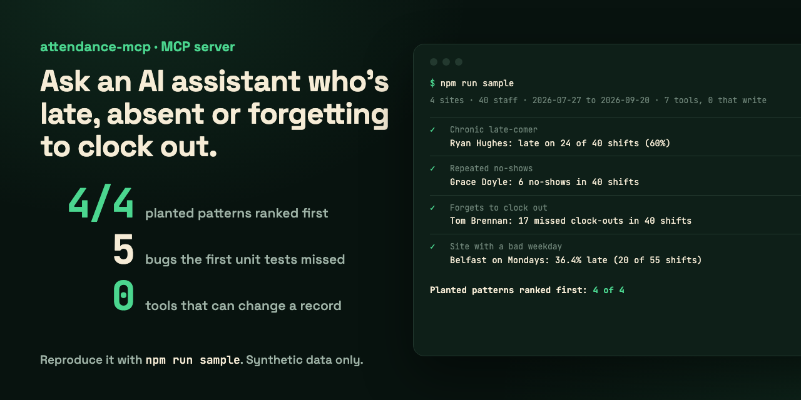
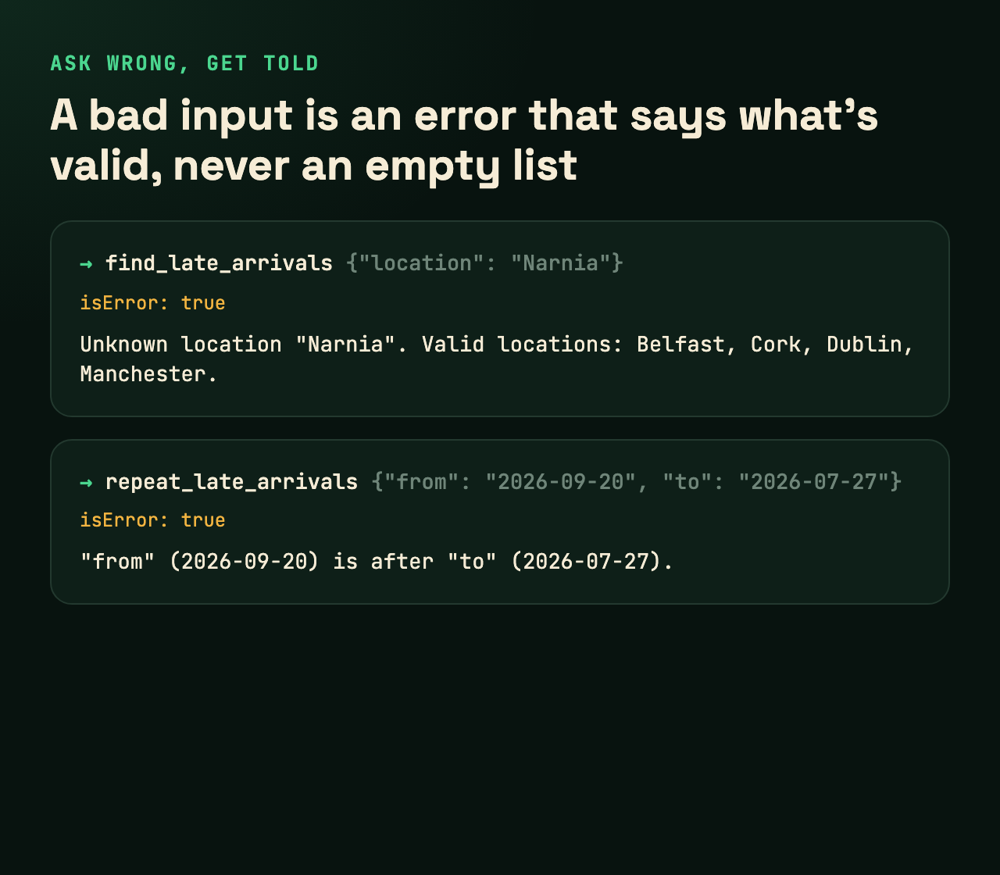
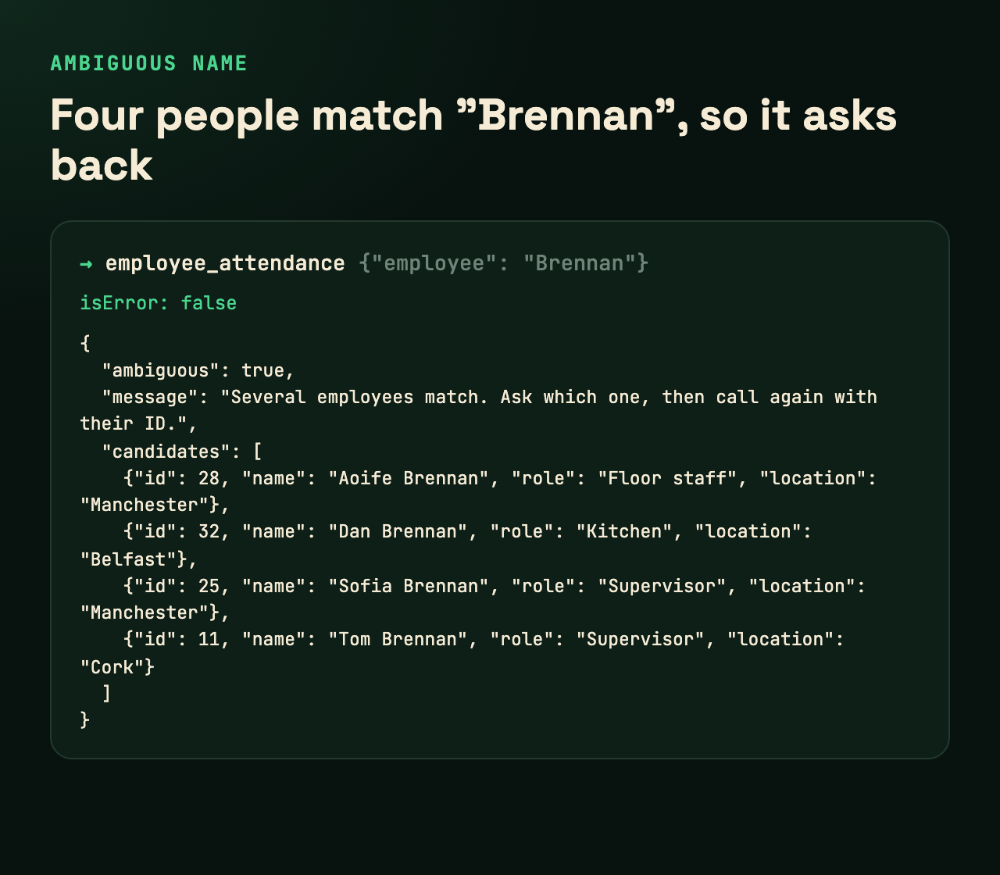
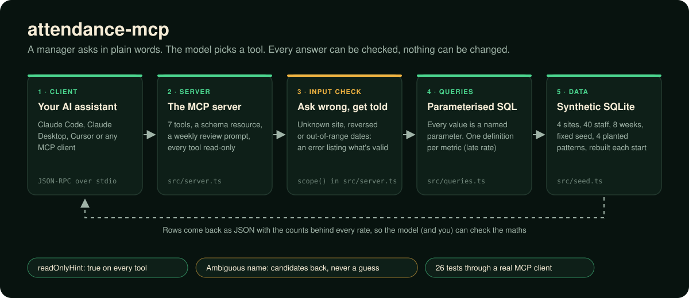

# attendance-mcp

**Ask an AI assistant who's late, absent or forgetting to clock out.**

[](#results)
[](#ground-rules)
[](https://github.com/AIwithDiego/attendance-mcp/actions/workflows/ci.yml)


[](LICENSE)

[](#results)

```bash
git clone https://github.com/AIwithDiego/attendance-mcp && cd attendance-mcp && npm ci && npm run build
claude mcp add attendance -- node --disable-warning=ExperimentalWarning "$(pwd)/dist/index.js"
```

An MCP server in TypeScript on the official SDK. Built in Dublin with Claude Code, September 2026, as the second version of an internal AI demo I made at a former job. Runs on synthetic data only.

**Works with:** Claude Code · Claude Desktop · Cursor · any MCP client ([setup](#run-it-yourself))

**[Install it](#run-it-yourself)** · **[See the results](#results)** · [Live test logs](docs/test-session-2026-09-25-run2.md)

**Contents:** [The problem](#the-problem) · [Research](#research) · [What it does](#what-it-does) · [Results](#results) · [The build](#the-build) · [What went wrong](#what-went-wrong) · [What I learned](#what-i-learned) · [Run it yourself](#run-it-yourself)

## The problem

A manager with several sites wants plain answers. Who is regularly late? Who keeps not turning up? Is one site worse on a certain day? The data to answer that sits in clock-in records, and getting a pattern out of them means knowing which report to open and reading it yourself.

An AI assistant can do the reading, but only if it can reach the data safely, and only if its answers can be trusted. With attendance, a wrong answer is about a real person:

- **An empty result reads as a fact.** If a misspelt site name returns nothing, the model says "nobody was late".
- **A guess becomes an accusation.** If "Brennan" matches four people, picking one is a mistake about someone's record.
- **Two meanings of one number** let the model compare things that don't compare.
- **Any write access** turns a reporting tool into something that can change a person's record.

> v1 was an agent with its own private tools, shown once to colleagues. v2 is a server any assistant can plug into, and every answer can be checked.

## Research

**What already exists.** v1 was an internal demo I built at a former job, at a company that makes workforce software, to show colleagues what AI could do. It was an LLM agent with a few custom tools that looked for lateness patterns in clock-in data. It was never live. Its weakness was structural: the tools lived inside that one agent, so nothing else could use them. The [Model Context Protocol](https://modelcontextprotocol.io) fixes exactly that: build the tools once as a server, and Claude Code, Claude Desktop, Cursor or any MCP client can connect. This repo is that idea rebuilt from scratch as an MCP server, with new code and new synthetic data. Nothing from v1 is in it.

**Who it's for.** Developers who want to put an AI assistant on top of their own product's data and want a small, tested example of an MCP server built carefully. The person in the story is a site manager asking questions in plain words, so every tool description and error is written for the model that answers them.

**The limits we chose.** These are the decisions:

1. **Read-only.** Every tool carries `readOnlyHint: true`, and an existing database file is opened read-only.
2. **An empty result means nothing happened.** Bad input is an error that lists what's valid, never an empty list.
3. **Ambiguity goes back to the model.** A name that matches several people returns the candidates and asks which one.
4. **One definition per metric.** `late_rate_pct` is late shifts over attended shifts everywhere, and the schema resource says so.
5. **No reasons.** The tools report patterns. They never guess why someone is late.

**What I didn't build.** No write tools (approving timesheets, editing shifts), no connector to a real workforce system, and no npm package yet. A server that can change records, or that reads real people's data, needs a different level of review. Synthetic data with planted patterns keeps every answer checkable.

## What it does

A manager asks a question in Claude Code or Claude Desktop. The model reads the tool descriptions, picks one, and gets back JSON with the counts behind every rate, so the answer can be checked.

| Tool | Answers |
|---|---|
| `list_locations` | What sites are there, how many people, what dates does the data cover? |
| `find_late_arrivals` | Who was late on a given day or week, worst first? |
| `repeat_late_arrivals` | Who is regularly late? Count, rate and average minutes late per person. |
| `repeat_missing_clock_events` | Who keeps not turning up, or forgets to clock out? |
| `missing_clock_events` | Every no-show and missed clock-out. |
| `employee_attendance` | One person's summary and incidents, by ID or part of a name. |
| `location_trends` | Late rate per site by weekday or by week. |
| Resource `attendance://schema` | The data model and definitions ("late", "no-show", "late rate"), so the model knows what the numbers mean. |
| Prompt `weekly_attendance_review` | Reviews one week for a site against the previous four and drafts a short summary for the site manager. |

<table>
<tr>
<td width="50%"></td>
<td width="50%"></td>
</tr>
<tr>
<td>A bad input is an error that says what's valid.</td>
<td>Four people match "Brennan", so it asks back.</td>
</tr>
</table>

Both are real responses from the built server over stdio ([source](docs/src/screens.html)).



1. **Seed** (`src/seed.ts`): 4 sites (Dublin, Cork, Manchester, Belfast), 40 staff and 8 weeks of shifts from a fixed seed, identical on every run. Four patterns are planted: a chronic late-comer, repeated no-shows, repeated missed clock-outs, and a site that runs late on Mondays.
2. **Queries** (`src/queries.ts`): the SQL. Every value from a tool call is a named parameter; nothing a caller sends is concatenated into SQL.
3. **Server** (`src/server.ts`): the tools, resource and prompt, zod schemas that bound every input, and one shared check in front of every tool.
4. **Entry point** (`src/index.ts`): connects to stdio. stdout is the protocol channel, so logs go to stderr.

## Results

**On the synthetic data, the tools rank all four planted patterns first, and none of the seven tools can write.**

| Planted pattern | What the tools returned |
|---|---|
| Chronic late-comer | Ryan Hughes, late on 24 of 40 shifts (60%). The next person is at 18.4%. |
| Repeated no-shows | Grace Doyle, 6 no-shows in 40 shifts |
| Forgets to clock out | Tom Brennan, 17 missed clock-outs in 40 shifts |
| Site with a bad weekday | Belfast on Mondays, 36.4% late (20 of 55 shifts), against 3 to 11% on its other days |

How it's measured: [`scripts/sample-analysis.mjs`](scripts/sample-analysis.mjs) starts the built server over stdio, the way Claude Code does, makes four tool calls and checks the planted names come out on top. It exits non-zero if any don't, and CI runs it on every push. Output: [`docs/sample-analysis.md`](docs/sample-analysis.md).

The same patterns came back in two live Claude Code sessions. Asked *"Who's regularly late in Manchester, and does any site have a bad day of the week?"*, Claude called `repeat_late_arrivals` and `location_trends` and answered:

> Ryan Hughes is the outlier: late on 24 of 40 shifts (60%), 22.8 minutes on average. The next person is at 18.4%. The bad day is **Belfast on Mondays**: 36.4% late against 3 to 11% on its other days, and it's spread across the site's staff, so it looks structural (start time, rota, transport) rather than one person. Manchester is flat by weekday because its problem is one person.

(Figures updated to the current late-rate definition; the session logs keep the originals.)

## The build

Built with Claude Code and published on 25 September 2026. The order: write the server, test it live in Claude Code, fix, test again, security review, publish.

| Milestone | What landed |
|---|---|
| [`7d14d5e`](https://github.com/AIwithDiego/attendance-mcp/commit/7d14d5e) | The server: 7 read-only tools, schema resource, review prompt, seeded data, tests through a real MCP client |
| [Live session 1](docs/test-session-2026-09-25.md) | 19 real tool calls from Claude Code. All planted patterns found; 3 bugs and 1 missing tool |
| [Live session 2](docs/test-session-2026-09-25-run2.md) | 87 calls across all seven tools after the fixes. All run-1 fixes held; 1 new bug, 3 rough edges and 1 design gap |
| [`bd34d42`](https://github.com/AIwithDiego/attendance-mcp/commit/bd34d42) | Security-review fixes (existing DB opens read-only and unseeded, capped results, pinned Inspector), CI on Node 22 and 24, Dependabot, 26 tests. Published as v0.1.0 |
| `docs/template-v2` | This README, `npm run sample` as a reproducible check, gitleaks in CI, contributing and security files |

The security review was done by Hank, my AI security reviewer ([public version](https://github.com/AIwithDiego/hank)). Its verdict was to ship, with the low findings applied in `bd34d42`.

## What went wrong

The two live sessions, and the tests written for their fixes, found five bugs, four rough edges and one missing tool. The first round of unit tests passed straight over all of them. Each now has a regression test.

| | |
|---|---|
| **An empty list is an answer, so it has to be a true one.** A misspelt site, reversed dates or dates outside the data returned `[]`, which the model would report as "nobody was late". One shared check now returns an error listing the valid options. | [regression tests](https://github.com/AIwithDiego/attendance-mcp/blob/bd34d42/test/server.test.ts#L141-L156) |
| **A date bug hid the exact pattern it should have shown.** SQLite's `weekday 1` leaves a Monday where it is, so `'-7 days'` pushed every Monday into the previous week. The planted pattern was a Monday effect. It showed up only because the weekly totals didn't add up (7 + 43 instead of 50 shifts). | [regression test](https://github.com/AIwithDiego/attendance-mcp/blob/bd34d42/test/server.test.ts#L123-L131) |
| **A shift can be two things at once.** A late shift with no clock-out was labelled only "late", so the incident list disagreed with the summary. Incidents now carry a list of types. | [regression test](https://github.com/AIwithDiego/attendance-mcp/blob/bd34d42/test/server.test.ts#L133-L139) |
| **Search strings are input too.** `%` or `_` in a name search matched all 40 employees, because they're `LIKE` wildcards. They're escaped now, and a blank search is an error. | [regression tests](https://github.com/AIwithDiego/attendance-mcp/blob/bd34d42/test/server.test.ts#L168-L178) |
| **One metric had two meanings.** The per-person late rate left no-shows out and the site trend put them in. Both now divide by attended shifts, and responses include the counts. | [regression test](https://github.com/AIwithDiego/attendance-mcp/blob/bd34d42/test/server.test.ts#L197-L206) |
| **No way to rank who keeps not turning up.** Session 1 found the planted no-shows only by counting by hand. `repeat_missing_clock_events` was added. | [regression test](https://github.com/AIwithDiego/attendance-mcp/blob/bd34d42/test/server.test.ts#L158-L163) |
| **The fix's test found the next bug.** The regression test for out-of-range dates turned up an error message naming a date the caller never sent. | [regression test](https://github.com/AIwithDiego/attendance-mcp/blob/bd34d42/test/server.test.ts#L180-L185) |

## What I learned

- **Tool descriptions are for the model.** Saying when to use each tool ("use for 'who is regularly late' questions") is what made Claude pick the right one first time in the live sessions.
- **Unit tests check what you thought of; a live session checks what a model does.** Every bug above passed the first unit tests and showed up within a few real calls.
- **Make the data plant its own answers.** Known patterns in synthetic data turn "looks right" into a check that passes or fails, which is what `npm run sample` does.
- **Errors are part of the interface.** An error that lists the valid sites lets the model recover in the same turn.
- **Tools inside one agent stay there.** v1's tools could only ever serve v1. As an MCP server, the same idea works in any client.

**What's next:** an npm package so it installs in one line.

## Ground rules

- **Read-only.** No tool can change a record, and an existing database file is opened read-only and never seeded.
- **Synthetic data only.** Every name, shift and clock event comes from `src/seed.ts`.
- **No guessing about people.** An ambiguous name returns candidates; the tools never suggest reasons for lateness.
- **Real data needs more than this.** Pointed at real clock-in records, this becomes a tool for monitoring workers, which the EU AI Act lists as high-risk (Annex III, point 4(b)) and which under GDPR needs a data protection impact assessment first. The choices above are a starting point for that, not a substitute.

## Run it yourself

Needs Node.js 22.13 or later (it uses the built-in `node:sqlite`).

1. `git clone https://github.com/AIwithDiego/attendance-mcp && cd attendance-mcp && npm ci && npm run build`
2. **Claude Code:** `claude mcp add attendance -- node --disable-warning=ExperimentalWarning "$(pwd)/dist/index.js"`
3. **Claude Desktop:** add this to `claude_desktop_config.json` and restart:
   ```json
   { "mcpServers": { "attendance": { "command": "node", "args": ["--disable-warning=ExperimentalWarning", "/absolute/path/to/attendance-mcp/dist/index.js"] } } }
   ```
4. Ask *"Who's regularly late in Manchester?"*, *"Who forgets to clock out in Cork?"* or *"Run the weekly review for Belfast, week of 14 September."* No AI client? `npm run inspect` opens the MCP Inspector.
5. Check the numbers: `npm test` (26 tests) and `npm run sample` (the four planted patterns).

The database lives in memory and is rebuilt on every start. Set `ATTENDANCE_DB=/path/to/file.db` to keep it on disk. Times are local to each site.

## Repo map

```
src/index.ts           entry point: stdio transport, logs to stderr
src/server.ts          tools, resource, prompt, input checks
src/queries.ts         parameterised SQL, one definition per metric
src/seed.ts            synthetic data from a fixed seed, with the planted patterns
test/server.test.ts    26 tests through a real MCP client, incl. a regression test per bug
scripts/               sample-analysis.mjs: the reproducible check behind the results
docs/                  live test sessions, sample analysis, diagram, images; docs/src/ draws them
```

## Credits

Built on the [Model Context Protocol](https://modelcontextprotocol.io) TypeScript SDK and its Inspector. Written with [Claude Code](https://claude.com/claude-code); security review by [Hank](https://github.com/AIwithDiego/hank). Contributing: [CONTRIBUTING.md](CONTRIBUTING.md). Security issues: [SECURITY.md](SECURITY.md).

## Licence

MIT · Made in Dublin by [Diego Bauer](https://www.aiwithdiego.com) · [LinkedIn](https://www.linkedin.com/in/diego-bauer-domeyko/)

Built by [AIwithDiego](https://www.aiwithdiego.com). Need something like this for your team? [Talk to me](https://www.aiwithdiego.com).
