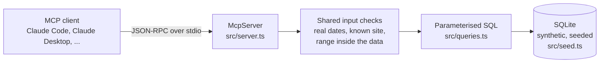

# attendance-mcp

**An MCP server that lets an AI assistant answer a manager's attendance questions: who is regularly late, who keeps not turning up, and which site has a bad day of the week.**

It exposes seven read-only tools, a schema resource and a review prompt over the [Model Context Protocol](https://modelcontextprotocol.io), so any MCP client (Claude Code, Claude Desktop, Cursor and others) can use them. It runs on synthetic data with known patterns planted in it, so every answer can be checked.

> Who's regularly late in Manchester, and does any site have a bad day of the week?

> Ryan Hughes is the outlier: late on 24 of 40 shifts (60%), 22.8 minutes on average. The next person is at 18.4%. The bad day is **Belfast on Mondays**: 36.4% late against 3 to 11% on its other days, and it's spread across the site's staff, so it looks structural (start time, rota, transport) rather than one person. Manchester is flat by weekday because its problem is one person.

That answer came from a live Claude Code session calling `repeat_late_arrivals` and `location_trends` (figures updated to the current late-rate definition, see below). The full sessions are in [`docs/`](docs/).

## Why I built it

In a previous role I built an LLM agent with a set of custom tools for exactly this job: finding lateness patterns in clock-in data across several sites, on synthetic data. Those tools lived inside one agent, so only that agent could use them.

MCP turns tools into a separate service with a standard interface: build them once, and any MCP client can connect. This repo is a from-scratch rebuild of that idea as an MCP server, with new code and new synthetic data.

## Tools

| Tool | Answers |
|---|---|
| `list_locations` | What sites are there, how many people, what dates does the data cover? |
| `find_late_arrivals` | Who was late on a given day or week, worst first? |
| `repeat_late_arrivals` | Who is regularly late? Count, rate and average minutes late per person. |
| `repeat_missing_clock_events` | Who keeps not turning up, or forgets to clock out? |
| `missing_clock_events` | List every no-show and missed clock-out. |
| `employee_attendance` | One person's summary and incident list, by ID or part of a name. |
| `location_trends` | Late rate per site by weekday or by week. |

Plus:

- **Resource `attendance://schema`**: the data model and definitions ("late", "no-show", "late rate"), so the model knows what the numbers mean before it reads them.
- **Prompt `weekly_attendance_review`**: reviews one week for a site against the previous four and drafts a short summary for the site manager.

Every tool is annotated `readOnlyHint: true`. Nothing in this server can change a record.

## Quick start

Requires Node.js 22.13 or later (it uses the built-in `node:sqlite`).

```bash
git clone https://github.com/AIwithDiego/attendance-mcp && cd attendance-mcp
npm ci && npm run build
```

**Claude Code:**

```bash
claude mcp add attendance -- node --disable-warning=ExperimentalWarning "$(pwd)/dist/index.js"
```

**Claude Desktop** (`claude_desktop_config.json`):

```json
{
  "mcpServers": {
    "attendance": {
      "command": "node",
      "args": ["--disable-warning=ExperimentalWarning", "/absolute/path/to/attendance-mcp/dist/index.js"]
    }
  }
}
```

**MCP Inspector** (click through the tools without an AI client): `npm run inspect`.

Then ask it things like *"Is anyone's lateness getting worse?"*, *"Who forgets to clock out in Cork?"* or *"Run the weekly review for Belfast, week of 14 September."*

## How it works



- `src/seed.ts` generates 4 sites (Dublin, Cork, Manchester, Belfast), 40 staff and 8 weeks of shifts and clock events from a fixed seed, so the data is identical on every run. Four patterns are planted: a chronic late-comer, repeated no-shows, repeated missed clock-outs, and a site that runs late on Mondays.
- `src/queries.ts` holds the SQL. Every value from a tool call is a named parameter; nothing a caller sends is concatenated into SQL.
- `src/server.ts` registers the tools, resource and prompt, with zod schemas that bound every input.
- `src/index.ts` connects the server to stdio. stdout is the protocol channel, so logs go to stderr.

## Design decisions

- **Tools are written for a model, not a human.** Descriptions say when to use each tool ("use for 'who is regularly late' questions"), because that's what the model reads when it picks one. In the live sessions it picked the right tool first time.
- **An empty result must mean "nothing happened", never "you asked wrong".** A model reports an empty list as fact. An unknown site, a reversed date range or dates outside the data return an error that says what's valid instead.
- **Ambiguity goes back to the model.** If a name matches several people, `employee_attendance` returns the candidates and tells the model to ask which one, instead of guessing.
- **Read-only by design.** Attendance data feeds conversations about real people. This server reports; it never edits.
- **One definition per metric.** `late_rate_pct` is late shifts divided by *attended* shifts in every tool, and it's written down in the schema resource.

## Testing

Two kinds:

1. **Automated: 26 tests** (`npm test`) that talk to the server through a real MCP client over an in-memory transport, the same protocol path Claude uses. They check the tools find every planted pattern, cover input validation and SQL injection attempts, and include a regression test for every bug below.
2. **Live sessions**: I connected the server to Claude Code and ran realistic manager questions and edge cases against it: 19 calls in the first session, 87 across all seven tools in the second. The write-ups, with evidence for each finding, are in [`docs/test-session-2026-09-25.md`](docs/test-session-2026-09-25.md) and [`docs/test-session-2026-09-25-run2.md`](docs/test-session-2026-09-25-run2.md).

CI runs typecheck, tests and build on Node 22 and 24.

## What I learned

The two live sessions and the tests written for their fixes found five bugs, four rough edges and one missing tool, all of which the first round of unit tests passed straight over. Each is fixed and has a regression test.

- **An empty list is an answer, so it has to be a true one.** A misspelt site name returned `[]`, which the model would report as "nobody was late". The same went for reversed dates and dates outside the data. The fix is one shared check in front of every tool, and errors that list the valid options so the model can recover.
- **A date bug hid the exact pattern it should have shown.** SQLite's `weekday 1` leaves a Monday where it is, so `'weekday 1', '-7 days'` pushed every Monday into the previous week. The planted pattern was a Monday effect. It showed up only because the weekly totals didn't add up (7 + 43 instead of 50 shifts).
- **A shift can be two things at once.** A late shift with no clock-out was labelled only "late", so the incident list disagreed with the summary. Incidents now carry a list of types.
- **Search strings are input too.** `%` or `_` in a name search matched all 40 employees, because they're `LIKE` wildcards. They're escaped now, and a blank search is an error.
- **One metric, one meaning.** The per-person late rate left no-shows out and the site trend put them in. Both now divide by attended shifts, and the response includes the counts so the maths can be checked.
- **Writing the test finds the next bug.** The regression test for out-of-range dates turned up an error message that named a date the caller never sent.

## Data

All names, shifts and clock events are synthetic, generated by `src/seed.ts`. By default the database lives in memory and is rebuilt on every start. Set `ATTENDANCE_DB=/path/to/file.db` to keep it on disk.

Times are local to each site; comparisons across sites ignore timezones.

An existing database file is opened **read-only** and never seeded, so pointing `ATTENDANCE_DB` at a database can't add tables or rows to it. Only a path that doesn't exist yet gets created and seeded.

## Using it on real data

This is a demo on synthetic data. Pointed at real clock-in records it becomes a tool for monitoring and evaluating workers, which the EU AI Act lists as high-risk (Annex III, point 4(b)) and which under GDPR needs a data protection impact assessment first. The design choices above (read-only, fixed definitions, no guessing at reasons for lateness) are a starting point for that, not a substitute.

## License

MIT
